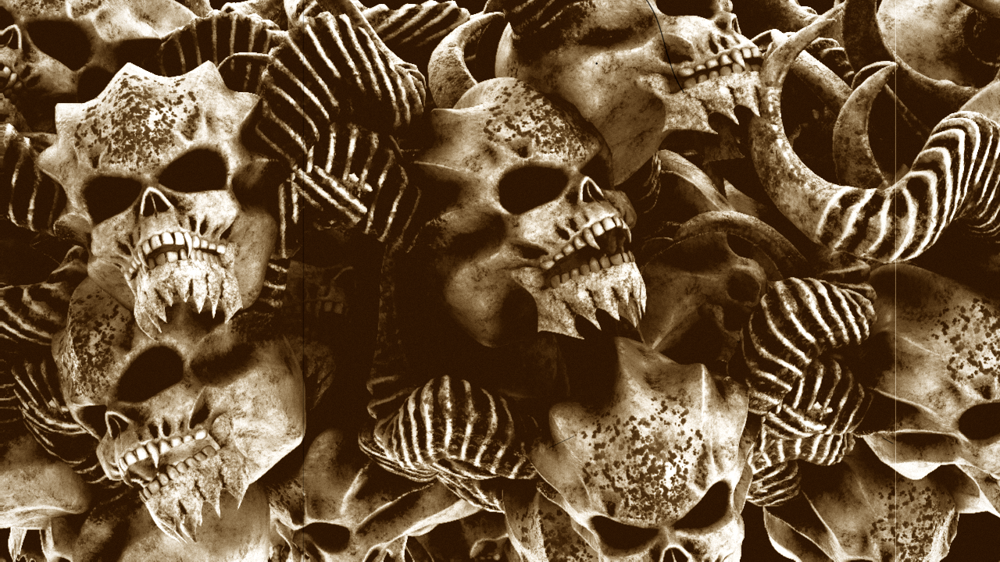
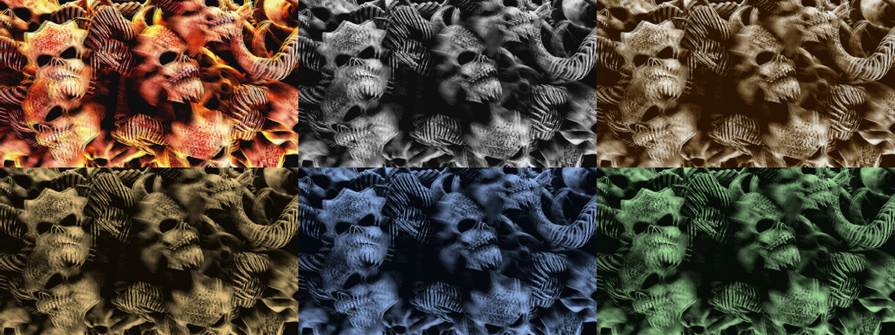
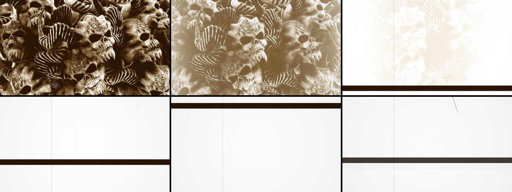

# handleman

> **AI-assisted project.** This codebase was created with [Claude](https://claude.com/claude-code)
> (Anthropic), directed and reviewed by a human author. Its behaviour is measured rather
> than asserted: an offline harness drives the plugin's own class in a headless GL context
> and reads each claim back out of the picture. The projector's hand changes how long each
> frame stays on screen and never what is on it; the camera's hand changes which instant
> each frame holds and never when it's shown; a frame cranked slowly prints lighter, at the
> print's gamma; sepia keeps its density law to a millionth and the tints theirs to a
> ten-millionth; the orthochromatic stock's weights read back out of the picture to four
> places; and Run Out ends in blank cells with a frame line of the published height,
> crawling up a pull-down at a time. Ten negative controls and a one-character mutant prove
> the checks can fail. It has **never been loaded into Resolume on macOS**; on Windows it
> loads and renders in Resolume Arena and passed the fleet's Arena checks. The full rundown
> is under [Status](#status).

A hand-cranked camera and projector, for your clip. Sepia or black and white, a frame rate
that won't sit still, the usual wear and tear on the print, and a button that runs the reel
out. An FFGL effect for [Resolume](https://resolume.com) Arena and Avenue.



<sub>One frame, rendered by `hmtest --pipe`, the offline harness, not captured from
Resolume. Resolume's bundled demo clip NoHopeJustFear_44 at the defaults, with Hair turned
up: orthochromatic stock, sepia toned, cranked at sixteen frames a second.</sub>

<!-- downloads:start -->

## Download

**[v0.1.0](https://github.com/stoatworks-labs/handleman/releases/tag/v0.1.0)** — prebuilt for macOS and Windows. Pick your platform:

<details>
<summary><b>macOS</b> — Universal (Apple Silicon + Intel)</summary>

| Build | Download | Size |
| --- | --- | --- |
| Universal (Apple Silicon + Intel) · .dmg disk image | [`handleman-0.1.0-macos-universal.dmg`](https://github.com/stoatworks-labs/handleman/releases/download/v0.1.0/handleman-0.1.0-macos-universal.dmg) | 245 KB |
| Universal (Apple Silicon + Intel) · .zip archive | [`handleman-macos-universal.zip`](https://github.com/stoatworks-labs/handleman/releases/latest/download/handleman-macos-universal.zip) | 204 KB |

</details>

<details>
<summary><b>Windows</b> — x64</summary>

| Build | Download | Size |
| --- | --- | --- |
| x64 · .exe installer | [`handleman-0.1.0-windows-x86_64-setup.exe`](https://github.com/stoatworks-labs/handleman/releases/download/v0.1.0/handleman-0.1.0-windows-x86_64-setup.exe) | 231 KB |
| x64 · .zip archive | [`handleman-windows-x86_64.zip`](https://github.com/stoatworks-labs/handleman/releases/latest/download/handleman-windows-x86_64.zip) | 123 KB |

</details>

All builds, checksums and release notes: [github.com/stoatworks-labs/handleman/releases](https://github.com/stoatworks-labs/handleman/releases).

macOS builds are signed and notarised and open normally. The Windows builds are unsigned, so SmartScreen warns once.

<!-- downloads:end -->

## The one idea

**Two people are turning handles, and neither of them is a motor.**

Before about 1927 a cameraman turned the camera, eight frames to a turn of the handle, two
turns a second if he was counting properly. At the other end a projectionist turned the
projector. Everything that makes old film look like old film follows from those two hands,
so that's what this models:

- **the camera's hand** decides when each frame was exposed. Its speed ripples once a turn
  (the arm pushes harder on the way down) and its count drifts over a few turns;
- **the projector's hand** decides how long each frame stays on the screen, and the shutter
  is geared to the handle, so it flickers faster and slower with it;
- **between them is a loop of film**: what the camera has exposed and the projector hasn't
  shown yet. Neither hand ever gets far ahead of the other, so the loop stays short.

The print going through the projector is silver on a nitrate base, and it's had a hard life.

## What falls out

None of this is drawn as an effect. Each is a hand, a shutter or a strip of film doing what
it does.

- **Motion speeds up and slows down.** Each frame holds the instant the camera's crank
  passed it. When the cameraman hurried, the frames are closer together in the scene's
  time, so played back steadily the action drags; when he slowed, they're further apart
  and it rushes.
- **The picture breathes in step.** The camera's shutter is a fixed angle, so a frame
  cranked slowly was exposed for longer and prints lighter, and a hurried one darker. The
  action rushes as the picture brightens, as it does on real silent footage.
- **The frame rate wobbles.** The projector's hand holds some frames longer than others,
  and the shutter's flicker against your display's 60 Hz wanders with it.
- **Orthochromatic film is blind to red.** Lips and skin go dark, skies go white: red
  exposes the stock about 5% as much as white does, green a third, blue two thirds.
  Panchromatic sees the world the way a modern black-and-white conversion does.
- **Sepia toning keeps its whites.** Toning converts the silver, so it only colours where
  there's silver: the shadows go brown and white stays white.
- **A tint keeps its blacks.** Tinting dyes the film, so it colours the light: the whites go
  amber (or blue for night, or green), and black stays black.
- **The grain belongs to the frame.** It holds still while a frame is on screen and changes
  at every pull-down, so it sparkles at the crank's rate, not your display's.
- **Weave, scratches, dust and a hair.** Each frame lands in the gate a little off. Grit in
  the gate cuts scratches that stay put while the picture moves under them, dark on the base
  side and white where they've taken the emulsion. Specks ride the print for a frame or
  two, white ones where the dirt was on the negative. Now and then a hair gets caught in the
  gate and trembles there until it shakes loose.



<sub>Tone, left to right and top to bottom: Colour, Black & White, Sepia, Amber Tint, Blue
Tint, Green Tint, all orthochromatic except Colour. Rendered by `hmtest --pipe`. This
display frame caught a pull-down with the shutter open, so it shows two frames at once,
which a projector does too.</sub>

[](https://www.youtube.com/watch?v=yHAiZe-qLzk)

*[Watch it](https://www.youtube.com/watch?v=yHAiZe-qLzk) — 78 seconds, and it flickers, as old
film does: the defaults on the skull clip, the cameraman's hand at full (the action rushing as
it brightens and dragging as it darkens), the projectionist's, the crank slow and fast, the two
stocks on orange figures in blue boots, every tone, the wear turned up to show the frame line,
and a run-out through all three tails to a new roll. Rendered by `hmtest --pipe` over
Resolume's demo clips, not captured from Resolume.*

## Run Out

Press **Run Out** and the roll runs out. From the next frame light gets into the film: the
picture fogs and burns out to white, from the edges in, over **Run Out Time**. After that
every frame is a blank cell, white in the gate and black at the frame line, and as the
tail goes through, the projector loses its loop and the frame line crawls up the screen.



<sub>Press to blank cells in about a second at the defaults, rendered by `hmtest --pipe`.</sub>

**Tail** picks the ending. **Rolling** keeps the cells crawling until you do something
about it. **Framed** is the projectionist reaching for the framing knob: the line creeps off
the screen and you're left on a blank white cell. **Off the End** is the tail whipping out
of the gate and the lamp shining on nothing at all.

Press Run Out again to thread a new roll: a few blank cells of leader, the fog clearing
back to your picture, and the frame line coming to rest. Pressing it halfway through either
of those turns it round from wherever it had got to.

## Controls

| Group | |
| --- | --- |
| **Crank** | Crank Rate (8–24 frames a second), Camera Hand (how far the cameraman wanders: up to 50% either way), Projector Hand (the projectionist: up to 40%), Blades (1, 2, 3), Shutter Angle (each blade's opening, 45–315°). |
| **Print** | Stock (Orthochromatic, Panchromatic), Tone (Colour, Black & White, Sepia, Amber Tint, Blue Tint, Green Tint), Contrast (the print's gamma, 0.6–2.2), Grain. |
| **Wear** | Weave, Scratches, Dust, Hair, Framing (±half a frame, which shows the frame line). |
| **Run Out** | Run Out (press), Run Out Time (0.25–4 seconds), Tail (Rolling, Framed, Off the End). |
| **Output** | Vignette (the lens's cos⁴ falloff to the corners), Mix. |

The defaults are sixteen frames a second with both hands a bit unsteady, a three-blade
shutter, orthochromatic stock, sepia toning and a print that's been round a few cinemas.
Colour keeps your clip's colours and just puts the hands and the wear on it; Stock does
nothing there.

> **Photosensitivity.** The shutter flickers against your output's refresh, and the
> projector's hand moves that beat around, so on a flat grey the light steps by up to about
> 20% from one display frame to the next at the defaults, mostly at 12–15 Hz, inside the
> 3–30 Hz band broadcast flash guidelines restrict. The default shutter is the gentlest the
> projector has (3 blades at 315°). Two blades at 180°, the classic, is a lot worse. Camera
> Hand at 0 stops the breathing, and Projector Hand at 0 makes the beat regular.

The output is opaque at Mix 1: the projection paints the whole frame, and a transparent
part of the clip prints as black film.

## Status

**v0.1.0, 16 October 2026: measured offline on macOS, and gated in Resolume Arena on Windows.**

### Measured offline, on macOS

`tools/verify.sh` passes on this machine (M4 Max, macOS 26.4) against a fresh universal
Release build, with every check at 320×180 and 1280×720 and again on Apple's software
renderer. Most of the checks feed the plugin a picture whose top strip says, in black and
white blocks, which display frame it was, so the screen says when the camera exposed what's
on it.

- **The hands.** With both still, 598 of 598 display frames show the picture a steady clock
  predicts. The projector's hand alone (40%): every picture is the steady camera's, in
  order, each held for 2 to 8 display frames and shown 1 to 10 after it was exposed, inside
  the loop's limit of 19.9. The camera's hand alone (50%): every switch is where a steady
  projector 2.64 frames behind puts it, every pull-down brings a newer picture, and over a
  turn the scene runs at 0.77 to 1.37 of real time. Both: 466 pictures in 29 seconds,
  against 463.7 at sixteen a second.
- **Exposure.** A frame's light against the camera's interval around it: log light rises
  with log interval at a slope of 1.440, against the print's gamma of 1.40.
- **Flicker.** Gate's shutter, at Handleman's rates: every DFT bin of a flat grey's
  brightness within 2.3e-8 of the shutter's Fourier series.
- **Tone.** Black & White is neutral to the last bit; the curve's straight line has the
  slope Contrast says to 1.4e-3; sepia keeps its density law to 1.3e-6 and the tints theirs
  to 1.1e-7; the stocks' weights read back out of the picture as 0.0482 / 0.3331 / 0.6460
  (orthochromatic red, green, blue) against 0.0482 / 0.3331 / 0.6459 computed.
- **Hold.** Within a hold the grain and dust don't move (to 2.2e-7); across a pull-down
  they do.
- **Scratches** take their own columns, and only theirs, on every frame of a moving,
  weaving picture. **Weave** has the stated deviation and frame-to-frame correlation.
- **Run Out.** Blank cells are the clear base to float precision; the frame line is 41 or
  42 rows at 720 (41.32 from the film's pitch and aperture); Rolling climbs 47.55 rows a
  pull-down; Framed's line goes and stays gone; Off the End is the bare lamp; a second
  press has the picture back and framed within 161 display frames.
- **Resize.** The loop of film survives a resize to 1.5× and back, frame for frame.
- **Negative controls**, one per check, each a deliberate fault in the plugin's model, all
  fail; so does a one-character mutant of the shipped shader. **No dead controls**: all 19
  change the picture.
- **The bundle** is universal, and [oxbow](https://github.com/stoatworks-labs/oxbow), a
  real FFGL host, sees `SW Handleman`, `HM01`, an effect, and renders 120 frames through it.

Render cost, `hmtest --bench` (the defaults, best of three, `glFinish` both sides, a
shared GPU):

| | ms/frame | % of a 60 fps frame | state held |
| --- | --- | --- | --- |
| 1280×720 | 0.050 | 0.3% | 21 MB |
| 1920×1080 | 0.066 | 0.4% | 47 MB |
| 3840×2160 | 0.175 | 1.0% | 190 MB |

The state is the loop of film: a stack of 8-bit pictures at the input's size, as deep as
the hands have needed. That's six at the defaults and twelve with both hands at full, so
up to about 400 MB at 4K.

### In Resolume Arena, on Windows

In **Resolume Arena 7.27.1 on Windows** (win-lab: Mesa llvmpipe, software rendering, no GPU,
no sound device) the x64 build loads, registers as `SW Handleman` (`HM01`, an effect) and
renders, and passed all 9 of the fleet's Arena checks that can run there, three times: twice on
a build compiled on win-lab by MSVC 19.44 without a warning, and once on the shipped v0.1.0
`handleman-windows-x86_64.zip` itself. All 25 controls (Arena's Opacity, the plugin's 19 and the About
block's 5) match their declarations, the two names at FFGL's 16-character limit arrive whole,
and Arena's log stays clean.

The gate measures each control against a still picture, and Handleman never stands still on
its own: new grain at every pull-down, the weave, dust, scratches coming and going, the
flicker. So in the first run, at the defaults, 8 controls measurably changed the picture and
9 were too close to call. In the second, with the grain, the wear and both hands held at 0
while every other control was measured, 12 did: Camera Hand, Grain, Dust and Scratches
joined Opacity, Stock, Tone, Contrast, Weave, Framing, Vignette and Mix. Crank Rate, Blades,
Shutter Angle and Projector Hand, which change how the light varies over time rather than
what's in the picture, and Hair, a rare event, were too close to call in both. The third run,
on the shipped zip with the second's expectation, found 15: Blades, Shutter Angle and
Projector Hand moved the picture there, and only Crank Rate and Hair were too close to call.
A verdict on a picture that moves by itself changes from run to run. None read dead. Run Out Time and Tail only act after a Run Out press, which the gate never sends.
Software rendering says nothing about a GPU or about speed. The expectation is
plugin-bench's `arena/expect/handleman.json`.

### Not established

On macOS it's **never been loaded into Resolume**: everything above the Windows section was
compiled, rendered and measured offline against the plugin's own class in a headless CGL
context, plus an `oxbow` load. Nobody has looked at its panel in Resolume on a Mac, or run
it on a GPU inside Resolume.

The published figures are the eight frames a turn and the film's apertures and pitch. The
rest (how the hands wander, the jerk, the slip, the fog, the grain, the tones' colours) are
numbers I picked to look and behave right, not measurements of a cameraman or a print. The
orthochromatic sensitivity is an assumed shape, not a digitised curve. I've only seen it on
Resolume's bundled demo clips. A 16-bit composition is quantised to 8 bits in the loop.
AGENTS.md lists every approximation and open question.

There's a [user guide](docs/USER-GUIDE.md). No OpenFX port, browser demo or presets yet.

## Build

macOS (universal: Apple Silicon and Intel):

```bash
git clone --recurse-submodules https://github.com/stoatworks-labs/handleman
```

```bash
cmake -B build -DCMAKE_BUILD_TYPE=Release
```

```bash
cmake --build build
```

```bash
cmake --install build
```

The last one copies `Handleman.bundle` into `~/Documents/Resolume Arena/Extra Effects`.
Restart Arena and it's under Effects as **SW Handleman**.

Windows needs Visual Studio 2022 and vcpkg (for GLEW); see `.github/workflows/ci.yml`.

## Building and testing

```bash
tools/verify.sh
```

That's the lot: a fresh universal build, every check at two rasters and on the software
renderer, the negative controls, the sweep for dead controls, the stocks' weights, the
bundle's architecture and plist, an ad-hoc signature, a host's view of it through `oxbow`,
the pipe's frame format and the render cost. `CLAUDE.md` lists the checks one by one.

Run your own footage through it, with a run-out two seconds in:

```bash
printf '120 Run Out 1\n' > /tmp/cues.txt
```

```bash
ffmpeg -i clip.mov -vf fps=60 -f rawvideo -pix_fmt rgba - | ./build/hmtest --pipe --size 1280x720 --script /tmp/cues.txt | ffmpeg -f rawvideo -pix_fmt rgba -s 1280x720 -r 60 -i - out.mov
```

## License

MIT. See [LICENSE](LICENSE) and [ATTRIBUTIONS.md](ATTRIBUTIONS.md).

<!-- attributions:start -->
This project is built on other people's work — see [ATTRIBUTIONS.md](ATTRIBUTIONS.md).
<!-- attributions:end -->
